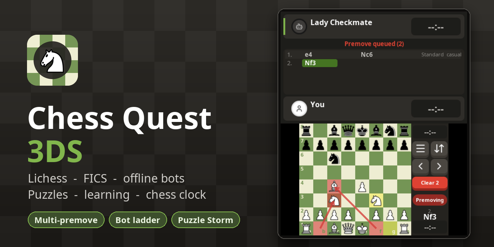

# Chess Quest 3DS



A chess app for the Nintendo 3DS / 2DS family. Play on **Lichess**, on **FICS**, or completely **offline** against a ladder of bots
that run on the console itself. Puzzles, learning tools, a game-review function and a chess clock for real boards are built in.

> **Unofficial.** This is a fan-made client. It is not made by, endorsed by or affiliated with Lichess, FICS or Nintendo.
> Status: hobby project / beta. Developed with the Azahar emulator and tested on a 2DS XL.
>
> **Built with AI assistance.** Most of the code was written by AI coding assistants (Claude Code and Antigravity). The author directed the project, chose the features and tested every build, in the emulator and on a real console.

## Features

**Playing**
- **Lichess** through the Board API: quick pairing, play a friend, challenge from the friends list, AI opponents (Stockfish on the Lichess servers), the variants the API offers.
- **FICS** (freechess.org): guest login or your own account, seeks, premoves, game history.
- **Offline bot ladder**: 12 named bots (from *Pip* to *Lady Checkmate*). Beat a bot to unlock the next one. No account, no Wi-Fi. A custom offline game against the built-in engine is available too.
- **Multi-premove**: queue up to 8 premoves; they are played the moment it is your turn (Lichess, FICS and bots).
- Drag-and-drop or tap-tap moves, board themes, four piece sets, sounds, left- or right-handed board position.

**Learning and training**
- Puzzles (Lichess puzzle API; rated with a token, unrated without an account) and **Puzzle Storm** (3 minutes). Fetched puzzles are kept on the SD card for offline play.
- **Opening trainer** (14 main lines) and **endgame training** against the engine (queen, rook, two bishops, bishop + knight, K+P, Lucena).
- **Game review**: the built-in engine marks blunders, mistakes and inaccuracies in any game; analysis board with opening explorer and cloud evaluation.

**Social / Lichess extras**
- Rating history graph, arena tournaments (browse and join), Lichess TV (watch live), friends list with online status and a follow button after a game.

**For real boards**
- **Chess clock**: put the console between two players. D-pad (or L) stops the left clock, A / B / X / Y (or R) stops the right one; touching a half works too. Increment or delay, presets from 1+0 to 30+0, low-time beeps.

**Built for the console**
- Own chess engine (alpha-beta search with transposition table, killer/history heuristics and late-move reductions) that runs on the 3DS CPU in a background thread.
- Step-by-step in-app guide for creating a Lichess token, and a hint when the console clock is wrong (that breaks secure connections).

## Install

1. A 3DS with custom firmware.
2. Download `ChessQuest3DS.cia` (or the `.3dsx`) from the Releases page. Install the CIA with FBI, or copy the `.3dsx` to `sdmc:/3ds/`.
3. Check that the console clock (System Settings > Other Settings > Date & Time) is correct. Secure connections fail otherwise.

### Update check

Once a day the app asks the public GitHub API (`api.github.com`) whether a newer release of this project exists. If so, Home shows "Update available" with the address of the Releases page. Nothing is downloaded or installed, and any failure (no Wi-Fi, wrong clock, GitHub down) is ignored silently. GitHub sees your IP address and the user agent `ChessQuest3DS/<version>`, nothing else, and your Lichess token is never sent there. Switch it off in Settings > *Check for updates*.

### Lichess account (optional)

Lichess apps use personal API tokens instead of passwords.

1. Open <https://lichess.org/account/oauth/token> on a phone or PC, create a token and tick: `board:play`, `challenge:read`, `challenge:write`, `puzzle:read`, `puzzle:write`, `follow:read`, `follow:write`, `tournament:write`.
2. On the 3DS choose *Enter token* and type it, **or** save it as `sdmc:/lichess3ds/token.txt` and press *Load token.txt*.

The token only lives on your console and is only sent to lichess.org. **Never commit it** (`token.txt` is in `.gitignore`).

Without an account you can still use the bot ladder, endgames, openings, the analysis board, the chess clock, FICS as a guest, and **puzzles and Puzzle Storm** (they load anonymously and are unrated). A token is needed for playing on Lichess, rated puzzles, tournaments, the friends list, rating history and Lichess TV.

## Building

Requirements: [devkitPro](https://devkitpro.org/) with the packages `3ds-dev`, `3ds-curl`, `3ds-mbedtls`, `3ds-jansson`, `3ds-zlib`.

```sh
# in a devkitPro shell (DEVKITPRO and DEVKITARM set)
make            # builds Lichess3DS.3dsx
```

On Windows, `powershell -File tools\build.ps1` runs the same inside the devkitPro MSYS2 shell.
The generated graphics and fonts in `romfs/` and `source/ui_atlas.h` are committed. To regenerate them use `tools/make_assets.py` (Python, Pillow, resvg-py, `tex3ds`) and `tools/make_sounds.py` (numpy).

**CIA:** `powershell -ExecutionPolicy Bypass -File tools\build_cia.ps1` needs `makerom` (devkitPro) and `bannertool`, which you download yourself into `tools/bin/`. The banner is made by `tools/make_banner.py`.

## Tests

```sh
sh tests/run_tests.sh      # host-side unit tests, plain C (gcc or clang)
```

They cover the move generator (perft), 400+ real Lichess games of every variant, SAN, premoves, the FICS parser, puzzles, the engine, the opening/endgame data and the strength ordering of the bot ladder.

The whole app can also be driven unattended in the Azahar emulator with scenario scripts (`tests/scenarios/*.txt`, runner `tools/az_run.ps1`), which take screenshots and check the log. `tools/promo_record.ps1` and `tools/make_promo.py` build the promo video from such a run.

## Layout

| Path | What |
|---|---|
| `source/chess.c`, `engine.c`, `premove.c`, `puzzle.c`, `bots.c`, `learn_data.c` | portable game logic (also used by the host tests) |
| `source/scene_*.c` | screens (home, game, play, puzzles, bots, learn, analysis, social, clock, settings) |
| `source/lichess.c`, `api.c`, `fics.c` | network layers |
| `source/gfx.c`, `ui.c`, `board.c`, `audio.c` | citro2d rendering, widgets, board, sound |
| `tests/` | host unit tests, test data, emulator scenarios |
| `tools/` | asset generators, build and CIA scripts, emulator harness |
| `assets_src/` | piece sets, icons, fonts, CA bundle (sources of the generated `romfs/`) |

## Known limitations

- Tested in Azahar and on one 2DS XL; the 3D effect is not used.
- Lichess restricts which time controls third-party apps may start through the Board API; the Quick tab offers what the API allows.
- Joining tournaments, challenging from the friends list and rated puzzle submission follow the API documentation but have had little live testing.
- Bot strength has only been compared between the bots, not measured against rated engines.

## Credits

This project stands on the work of many people. Thank you!

**Lichess** - <https://lichess.org>, free and open source ([lila](https://github.com/lichess-org/lila), AGPLv3+). This app uses the Lichess API (Board, challenges, puzzles, tournaments, TV, opening explorer, cloud evaluation, rating history, relations). Online AI opponents are Lichess's Stockfish. The look and feel of several screens is inspired by Lichess. Test games come from public Lichess games. The piece sets below come from the lila repository (see its [COPYING](assets_src/COPYING_lila.md)).

**Free Internet Chess Server (FICS)** - <https://www.freechess.org>, a long-running free chess server (style-12 protocol).

**Piece sets** (from lila; each set keeps its own license)

| Set | Author | License |
|---|---|---|
| cburnett | Colin M.L. Burnett | GPLv2+ |
| merida | Armando Hernandez Marroquin | GPLv2+ |
| chessnut | Alexis Luengas | Apache 2.0 |
| rhosgfx | RhosGFX | CC0 1.0 |

**Fonts and icons** - Noto Sans (Google, as shipped with lila; Apache 2.0). Icon shapes from [Lucide](https://lucide.dev) (ISC license).

**Libraries and tools**
- [devkitPro](https://devkitpro.org/): devkitARM, [libctru](https://github.com/devkitPro/libctru), [citro2d / citro3d](https://github.com/devkitPro/citro2d), 3dsxtool, smdhtool, tex3ds, makerom
- [curl](https://curl.se/), [Mbed TLS](https://www.trustedfirmware.org/projects/mbed-tls/), [jansson](https://github.com/akheron/jansson), [zlib](https://zlib.net/)
- Mozilla CA certificate bundle (`cacert.pem`, MPL 2.0), via [curl.se/docs/caextract.html](https://curl.se/docs/caextract.html)
- [bannertool](https://github.com/Steveice10/bannertool) (banner for the CIA)
- [Azahar](https://azahar-emu.org/) 3DS emulator, used for development and the automated screenshot tests
- Python, Pillow, numpy, resvg-py (asset generation) and ffmpeg (promo video)

**Original to this project** - the chess engine (alpha-beta search written from scratch, not derived from Stockfish or another engine), the bot characters and names, the opening and endgame lessons, the chess clock, the board themes, the synthesised sound effects (`tools/make_sounds.py`) and the app logo.

"Nintendo 3DS" and "Nintendo 2DS" are trademarks of Nintendo. "Lichess" is a trademark of its owners.

## License

Chess Quest 3DS is free software, licensed under the **GNU General Public License v3.0 or later** (GPL-3.0-or-later). See [LICENSE](LICENSE). Copyright (c) 2026 LunaSkyx.

Bundled third-party material keeps its own license (see Credits): the piece sets are GPLv2+ (cburnett, merida), Apache 2.0 (chessnut) and CC0 (rhosgfx), the CA bundle is MPL 2.0, the libraries are used under their own permissive licenses. All of these are compatible with GPL-3.0-or-later. Pieces released only under non-commercial terms (such as the lila sets cardinal and staunty) are deliberately not included for that reason.
